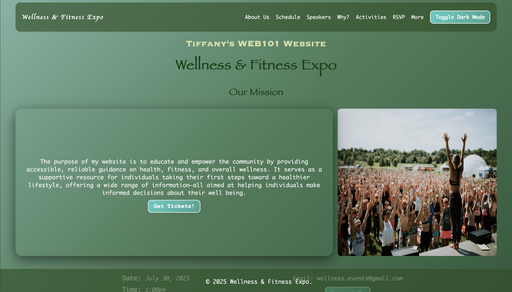
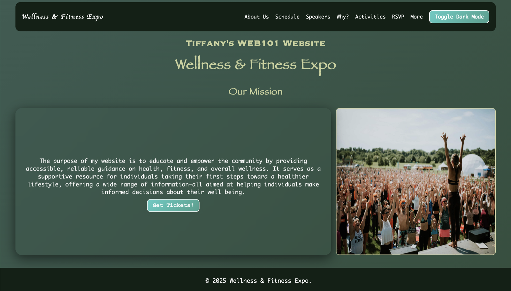
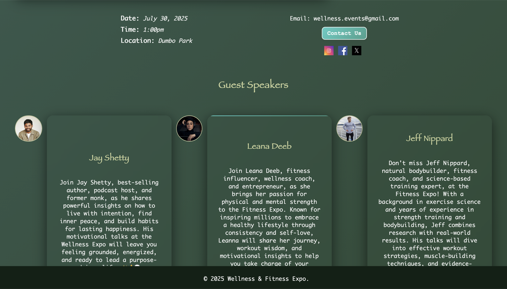
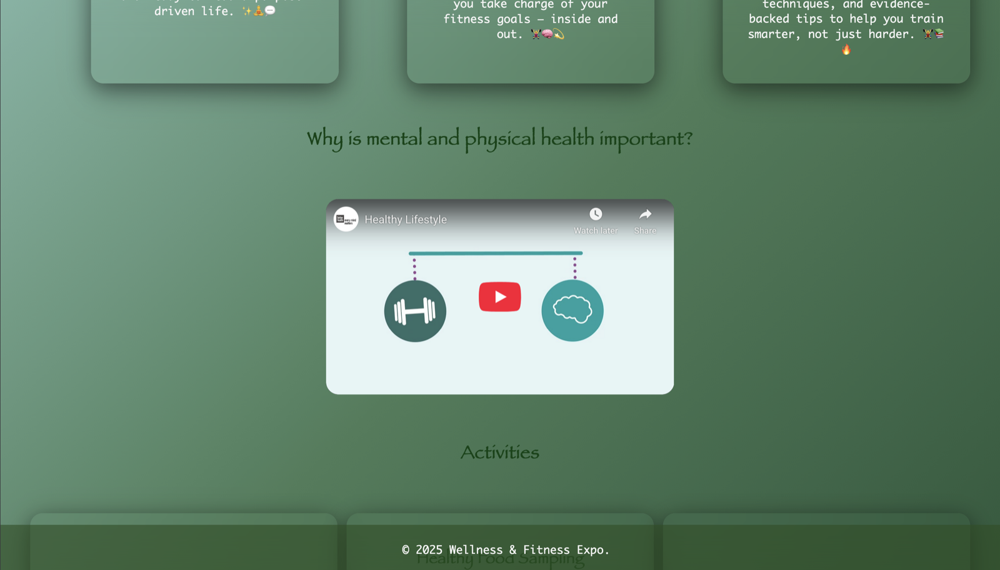
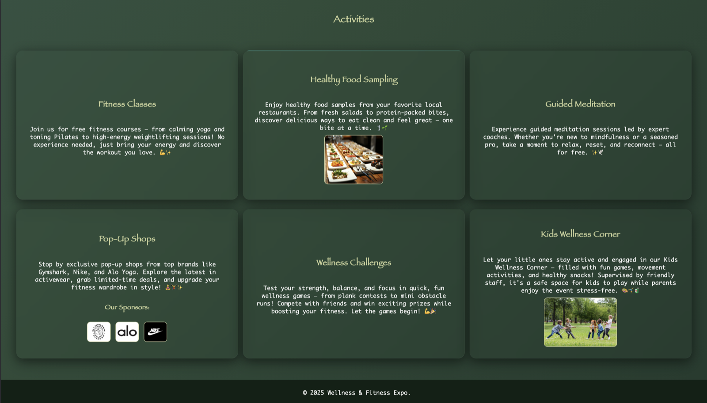
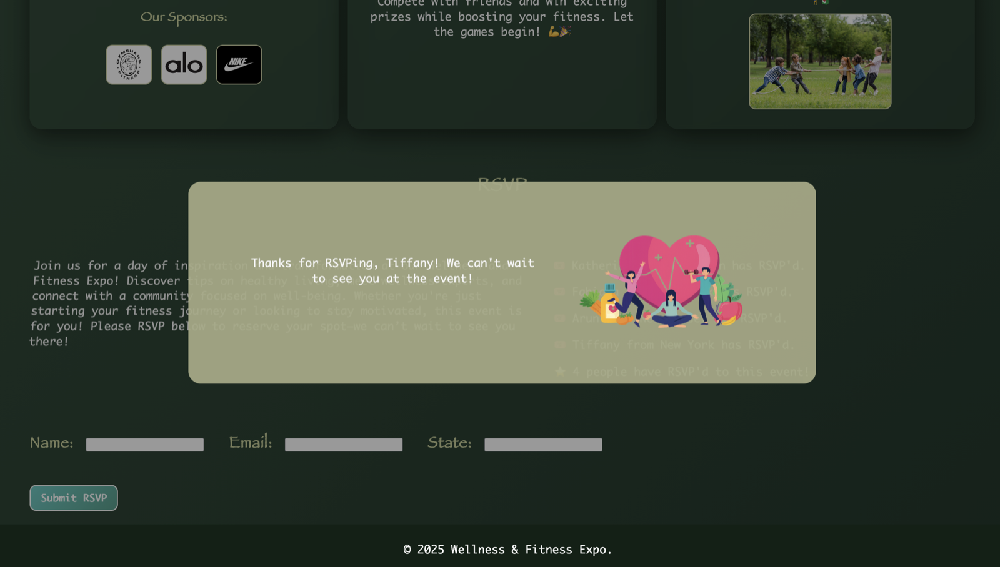

# 🧘‍♀️ Wellness & Fitness Expo 💪

This is a landing page for a community health and fitness expo, built for CodePath's WEB101 Web Development course. The goal was to make wellness feel approachable — clear, trustworthy guidance for anyone taking their first steps, and a bit of motivation for those already on the way. It brings everything into one place: what the event is about, who's speaking, and how to reserve a spot.

## ✨ Features

- **Sticky navigation bar** with anchor links that jump to each section of the page
- **Dark mode toggle** — a button in the navbar that switches the whole page between light and dark themes
- **RSVP form** with client-side validation:
  - Name, email, and state are all required
  - Fields shorter than 2 characters are flagged with an error style
  - Email must contain both `@` and `.com`
- **Live participant list** — a valid submission appends the new attendee to the RSVP list and increments the "people have RSVP'd" counter in the DOM
- **Animated success modal** — on a successful RSVP, a personalized confirmation modal appears with a rocking image animation (`setInterval`) and auto-dismisses after 5 seconds
- **Embedded YouTube video** explaining why mental and physical health matter
- **Responsive flexbox layouts** used throughout for the speakers, activities, and schedule sections
- **Custom favicon** and a gradient background with subtle animated color shifts

## 📍 Sections

| Section | Contents |
| --- | --- |
| Our Mission | Purpose of the site + "Get Tickets" call to action |
| Schedule | Date, time, location, contact email, and social media links |
| Guest Speakers | Jay Shetty, Leana Deeb, and Jeff Nippard with photos and bios |
| Why? | Embedded video on the importance of mental and physical health |
| Activities | Fitness classes, food sampling, guided meditation, pop-up shops (with sponsor logos), wellness challenges, and a kids' corner |
| RSVP | Event pitch, running list of attendees, and the sign-up form |
| Links | Link out to CodePath for more events |

## 📸 Screenshots

### ☀️ Home — light mode
Hero, mission statement, and the "Get Tickets" call to action.



### 🌙 Home — dark mode
The same page after clicking **Toggle Dark Mode** in the navbar.



### 🗓️ Schedule & Guest Speakers
Event details and contact info, followed by the three speaker cards.



### 🎥 Embedded Video
The "Why is mental and physical health important?" YouTube embed.



### 🤸 Activities
Six activity cards, including the pop-up shops section with sponsor logos.



### 🎟️ RSVP Confirmation Modal
The personalized success modal that appears after a valid RSVP submission.



## 🛠️ Tech Stack

- **HTML5** — semantic page structure
- **CSS3** — flexbox layout, CSS custom properties, gradients, transitions, keyframe animations, and a `.dark-mode` theme class
- **Vanilla JavaScript** — DOM querying and manipulation, event listeners, form validation, `setTimeout` / `setInterval` animation


## 📂 Project Structure

```
.
├── index.html      # Page markup and content
├── styles.css      # All styling, including dark mode
├── index.js        # Dark mode, form validation, RSVP list, modal animation
└── images/
    ├── screenshots/  # Screenshots used in this README
    └── ...           # Photos, logos, sponsor assets, and favicons
```

## 🚀 Running Locally

```bash
git clone https://github.com/TiffanyCalle/CodePath-Website.git
cd CodePath-Website
open index.html
```

## 🧠 What I Learned

- Structuring a multi-section page with semantic HTML and anchor navigation
- Building responsive layouts with flexbox
- Theming a site with CSS variables and a single toggled class
- Selecting and manipulating DOM elements, creating new elements on the fly
- Handling form submission events, preventing default behavior, and validating user input
- Creating timed animations with `setInterval` and cleaning them up with `clearInterval`

